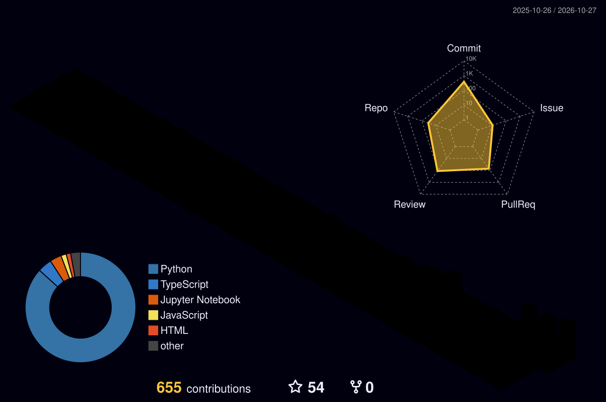

<div align="center">

# Ayush Tiwari

### AI/ML Engineer · Agentic AI Developer · Open-Source Contributor
**Indian Institute of Technology Guwahati**

Building reliable machine learning systems, intelligent agents, and data-driven applications.

[](https://www.ayushtiwari.tech)
[](https://linkedin.com/in/ayus-tiwari)
[](https://www.kaggle.com/ayushtiwariiitg)
[](mailto:ayushtiwaridsai@gmail.com)


</div>

---

## About Me

I'm a Data Science and AI undergraduate at **IIT Guwahati**, with hands-on experience in machine learning, deep learning, LLM applications, and AI product evaluation.

My work focuses on building systems beyond notebooks — from data preprocessing and model training to evaluation, API integration, monitoring, and deployment.

- **AI Engineering:** LLM applications, RAG, agent workflows, and evaluation
- **Machine Learning:** Predictive modeling, deep learning, and computer vision
- **MLOps:** Model monitoring, drift detection, retraining, and reproducibility
- **Software Engineering:** Python backends, APIs, testing, and automation
- **Open Source:** Exploring and contributing to AI/ML tooling and developer infrastructure

Currently interested in **Agentic AI, ML reliability, model evaluation, and scalable inference systems**.

---

## Selected Projects

### [SentinelML](https://github.com/Ayushdevo)

**ML Monitoring & Automated Retraining Pipeline**

A machine learning monitoring system designed to identify model degradation, detect data drift, and support retraining decisions.

**Technical highlights**
- Data drift and anomaly detection
- Model health monitoring and performance evaluation
- Retraining recommendations based on monitoring signals
- Classification metrics and uncertainty analysis

| Metric | Result |
|---|---|
| Accuracy | 98.00% |
| Precision | 98.77% |
| Recall | 94.12% |
| F1 Score | 96.39% |
| ROC-AUC | 0.9910 |

`Python` `Scikit-learn` `Pandas` `MLOps` `Model Monitoring`

### [CardioSense AI](https://github.com/Ayushdevo)

**ECG Arrhythmia Classification Using Deep Learning**

A CNN-based ECG classification project using the MIT-BIH Arrhythmia Database.

**Technical highlights**
- ECG signal preprocessing
- Convolutional neural network architecture
- Supervised classification of heartbeat patterns
- Model training and performance evaluation

**Reported accuracy:** ~96.6%

`Python` `TensorFlow` `Keras` `CNN` `Signal Processing`

### [Customer Segmentation](https://github.com/Ayushdevo)

**Customer Analytics & Intelligent Segmentation**

An end-to-end customer segmentation application combining unsupervised learning with interactive data exploration.

**Technical highlights**
- RFM-based customer feature engineering
- K-Means clustering
- Interactive Streamlit application
- AI-assisted customer insights
- Dockerized application workflow

**Reported cluster purity:** 94.2%

`Python` `Scikit-learn` `Pandas` `Streamlit` `Docker`

### [AyushGPT](https://github.com/Ayushdevo)

**Retrieval-Augmented Generation Assistant**

An LLM-powered assistant exploring retrieval-augmented generation and contextual question answering.

**Technical highlights**
- Document ingestion and retrieval
- Embedding-based semantic search
- LLM integration using LangChain
- Context-aware response generation

`Python` `LangChain` `LLMs` `RAG` `Vector Search`

### Aura — In Development

**Personal AI Digital Twin**

An experimental AI assistant focused on persistent context, tool-assisted reasoning, and personalized interactions.

**Exploration areas**
- Agent orchestration
- Context and memory management
- Tool calling and retrieval
- Evaluation and reliability

`Python` `FastAPI` `LLMs` `Agentic AI`

> Explore more work in my [GitHub repositories](https://github.com/Ayushdevo?tab=repositories).

---

## Engineering Stack

| Area | Technologies |
|---|---|
| Languages | Python, C++, Java, SQL |
| Machine Learning | PyTorch, TensorFlow, Keras, Scikit-learn |
| LLM Engineering | LangChain, LangGraph, Hugging Face, RAG |
| Data Engineering | Pandas, NumPy, DuckDB, SQL |
| Backend | FastAPI, Flask |
| Applications | Streamlit, React, Next.js |
| Infrastructure | Docker, Git, GitHub, Linux |
| Computer Vision | OpenCV, CNNs |
| Deployment | Vercel, Render |

---

## Experience

**Machine Learning Engineering Intern — FlyRank AI / 10x.ai**

- Worked through applied AI/ML engineering assignments and capstones.
- Completed 26 assignments and three accepted capstone projects.
- Gained practical experience in machine learning workflows and evaluation.

**AI Product Quality Intern — MeetIQ / Ajencel**

- Evaluated AI-generated content against reference information.
- Investigated semantic inconsistencies and output reliability.
- Documented evidence-backed findings for quality improvement.
- Worked with structured evaluation and validation workflows.

**AI Intern — Codec Technologies**

- Developed responsive interfaces using React and modern frontend tooling.
- Worked on application performance and user experience optimization.
- Integrated interactive components into web applications.

---

## Open-Source Engineering

I contribute to and study open-source projects across the AI/ML ecosystem, focusing on correctness, testing, reliability, and developer experience.

Areas of interest include:

- Regression testing and edge-case coverage
- Numerical stability in ML libraries
- Model execution and training workflows
- Agent framework reliability
- Documentation and developer tooling

**Projects I follow and work with:**

- [Hugging Face](https://github.com/huggingface)
- [Google DeepMind Optax](https://github.com/google-deepmind/optax)
- [LangGraph](https://github.com/langchain-ai/langgraph)
- [Evidently](https://github.com/evidentlyai/evidently)
- [OpenClaw](https://github.com/openclaw/openclaw)

[Explore my public contributions](https://github.com/Ayushdevo?tab=overview)

---

## GitHub Activity

<div align="center">


</div>

### 3D Contribution Graph

<div align="center">



</div>

### Contribution Timeline

<div align="center">


</div>

---

## Currently Exploring

```yaml
research_interests:
  - Agentic AI and tool-using systems
  - LLM evaluation and reliability
  - Retrieval-augmented generation
  - Machine learning observability
  - Production inference and optimization

engineering_priorities:
  - Reproducible experiments
  - Automated testing
  - Robust model evaluation
  - Maintainable software architecture
  - Meaningful open-source contributions
```

---

## Connect

I'm interested in collaborating on open-source ML tooling, applied AI research, intelligent agents, and reliable AI applications.

- **Website:** [ayushtiwari.tech](https://www.ayushtiwari.tech)
- **GitHub:** [github.com/Ayushdevo](https://github.com/Ayushdevo)
- **LinkedIn:** [linkedin.com/in/ayus-tiwari](https://linkedin.com/in/ayus-tiwari)
- **Kaggle:** [ayushtiwariiitg](https://www.kaggle.com/ayushtiwariiitg)
- **Email:** [ayushtiwaridsai@gmail.com](mailto:ayushtiwaridsai@gmail.com)

<div align="center">

**Build thoughtfully. Test rigorously. Improve continuously.**

</div>
